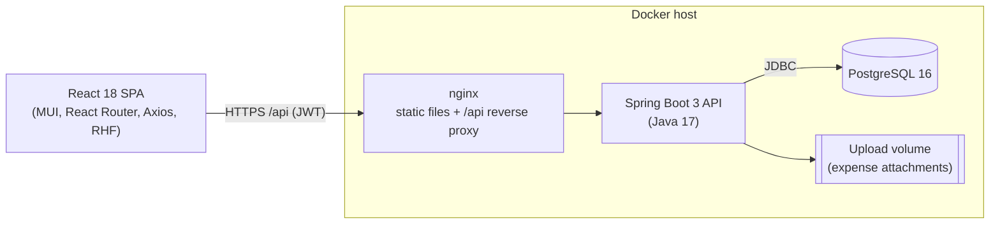

# CSSMS – Architecture

## 1. System context



* The SPA is served by nginx; `/api/**` is proxied to the backend, so the browser sees a single origin (no CORS in production).
* The API is stateless (JWT access token + rotating refresh token), so it can be scaled horizontally behind a load balancer. Attachments use a shared volume.

## 2. Backend layering (`backend/src/main/java/com/cssms`)

| Layer | Package | Responsibility |
|---|---|---|
| Controller | `controller` | HTTP mapping, `@Valid` request validation, `@PreAuthorize` role checks. No business logic. |
| Service | `service` | Business rules, transactions, stock/ledger/balance maintenance, report generation. |
| Repository | `repository` | Spring Data JPA + `Specification` filters + a few JPQL aggregates. |
| Domain | `entity`, `enums` | JPA entities (`BaseEntity` = id + audit columns + soft delete). |
| DTO | `dto` | Java records. Entities never leave the service layer. |
| Cross-cutting | `config`, `security`, `exception`, `util` | Security/JWT, OpenAPI, auditing, Jackson, global exception handling, helpers. |

Design points

* **DTO pattern** – request records carry Bean Validation annotations; response records are built in the services.
* **Global exception handling** – `GlobalExceptionHandler` maps everything to one `ApiError` JSON shape (400 validation with `fieldErrors`, 401, 403, 404, 409 business rule, 413, 500 without leaking internals).
* **Audit fields** – `created_at/by`, `updated_at/by` via Spring Data auditing (`AuditorAware` = current username). Every state-changing API call is also written to `audit_logs` by `AuditAspect` (user, action, entity, id, path, status, IP); login/logout/password events are logged explicitly.
* **Soft delete** – `deleted` flag + `@SQLRestriction("deleted = false")` on every entity; master records referenced by transactions cannot be deleted (use `INACTIVE`).
* **Pagination / sorting / search** – `Pageable` + `Specs` helper (`search`, `eq`, `between`). Sort properties are whitelisted per module (`Pages.safe`).
* **Reports** – every report is produced as a generic `ReportResponse` (columns, rows, summary). The UI renders it with a single table component and `ExportService` converts the same object to Excel (Apache POI) or PDF (OpenPDF), so on-screen and exported numbers cannot diverge.
* **Codes / numbers** – generated from PostgreSQL sequences (`EMP-0001`, `SUP-0001`, `CUST-0001`, `MAT-0001`, `PO-202610-00001`, `SO-202610-00001`, `INV-202610-00001`), which is safe under concurrency.

## 3. Security

* Spring Security, stateless, BCrypt password hashes.
* **Access token**: JWT (HS256), 30 min. **Refresh token**: 256-bit random, stored only as SHA-256 hash, 7 days, rotated on every use; re-use of a rotated token revokes all tokens of the user (theft detection). Logout, password change/reset, user deactivation revoke refresh tokens.
* The user is re-loaded on every request, so deactivating/deleting a user takes effect immediately.
* **Authorization**: method security (`@PreAuthorize`) mirroring the matrix in [API.md](API.md); the UI hides the same menu items, but the API is the source of truth.
* Forgot password: one-time token (30 min, hashed in DB). Delivery is a hook (`AuthService.forgotPassword`) – plug in e-mail/SMS; `app.security.expose-reset-token` returns the token in the response for local development only.
* Uploads: extension whitelist (pdf/png/jpg), server-generated file names, path traversal checks, 5 MB limit. Excel exports neutralise formula injection.
* `prod` profile has no default for `JWT_SECRET`/admin password (fails fast) and disables Swagger unless `SWAGGER_ENABLED=true`.

## 4. Core business rules

| Rule | Implementation |
|---|---|
| Current Stock = Purchased − Sold | `Inventory` row per material, locked (`PESSIMISTIC_WRITE`) on every movement; DB `CHECK (current_stock >= 0)`. |
| Purchase order | Posts stock in and a supplier-ledger **credit**. Edit/cancel reverses and re-applies, and is blocked once supplier payments exist or when the stock has already been sold. |
| Sales order | Validates stock and customer credit limit (`creditLimit = 0` ⇒ unlimited), posts stock out, a customer-ledger **debit** and (if an advance is given) an *advance* receipt + ledger **credit**. Invoice number is issued with the order. |
| Payments | Customer payments are made against an invoice (≤ pending), supplier payments against a PO (≤ balance). Both update paid/pending, payment status, customer outstanding and the ledgers; deleting a payment reverses all of that. |
| Payment status | `PENDING` (nothing paid), `PARTIAL_PAID`, `PAID`. |
| Ledgers | `customer_ledgers` (debit = sale, credit = receipt) and `supplier_ledgers` (credit = purchase, debit = payment). Statements compute opening balance from rows before *From Date*, then a running balance. |
| P&L | Revenue = Σ(sales − discount) excl. GST; Purchase cost = Σ PO amount excl. GST; Gross = Revenue − Purchase; Net = Gross − expenses. Mapping: Transport = loading charges, Office = office + electricity + rent. |
| Concurrency | Customer, sales-order, PO and inventory rows are locked in a consistent order (order → customer → inventory by id) inside one transaction. |

## 5. Frontend (`frontend/src`)

```
api/        axios client (JWT + silent refresh) and one module per backend area
context/    AuthContext (session, role helpers), NotificationContext (snackbars)
routes/     ProtectedRoute, RoleRoute, route table
layouts/    MainLayout (responsive drawer, role-based menu, profile menu)
components/ DataTable, FilterBar, ConfirmDialog, ReportTable (+export), StatCard, form field wrappers…
pages/      one folder per module (list + dialog/form), dashboard, auth pages, reports
utils/      formatters, constants (enums, role→menu matrix), error → form-field mapper
```

Role-based menus and route guards use one matrix (`utils/constants`) that matches the backend.

## 6. Testing

`CssmsApiIntegrationTest` boots the whole application against a **real PostgreSQL** (embedded, no Docker needed), runs the Flyway migrations, validates the JPA mapping (`ddl-auto=validate`) and exercises authentication, the role matrix, validation, the purchase → sale → payment → cancel lifecycle (stock, ledgers, outstanding balances), all reports, Excel/PDF export and invoice PDF.

```
cd backend && mvn test
```
