# CSSMS – Database ER Diagram

Source of truth: Flyway migrations in `backend/src/main/resources/db/migration` (`V1__init_schema.sql` = full DDL, `V2__reference_data.sql` = roles and the seven standard materials).

Common columns on every business table (omitted below): `created_at`, `updated_at`, `created_by`, `updated_by`, `deleted` (soft delete).

```mermaid
erDiagram
    roles ||--o{ users : "has"
    users ||--o{ refresh_tokens : "owns"
    users ||--o{ password_reset_tokens : "requests"

    suppliers ||--o{ purchase_orders : "supplies"
    purchase_orders ||--|{ purchase_order_items : "contains"
    materials ||--o{ purchase_order_items : "bought as"
    purchase_orders ||--o{ supplier_payments : "settled by"
    suppliers ||--o{ supplier_payments : "paid to"
    suppliers ||--o{ supplier_ledgers : "account"

    customers ||--o{ sales_orders : "orders"
    sales_orders ||--|{ sales_order_items : "contains"
    materials ||--o{ sales_order_items : "sold as"
    sales_orders ||--o{ customer_payments : "settled by"
    customers ||--o{ customer_payments : "pays"
    customers ||--o{ customer_ledgers : "account"

    materials ||--|| inventory : "stock of"

    roles { bigint id PK
        varchar name UK }
    users { bigint id PK
        varchar username
        varchar password_hash
        varchar full_name
        varchar email
        varchar mobile_number
        bigint role_id FK
        boolean active }
    refresh_tokens { bigint id PK
        bigint user_id FK
        varchar token_hash UK
        timestamp expires_at
        boolean revoked }
    password_reset_tokens { bigint id PK
        bigint user_id FK
        varchar token_hash UK
        timestamp expires_at
        boolean used }
    employees { bigint id PK
        varchar employee_code UK
        varchar full_name
        varchar mobile_number
        varchar email
        date joining_date
        numeric salary
        varchar designation
        varchar status }
    suppliers { bigint id PK
        varchar supplier_code UK
        varchar supplier_name
        varchar gst_number
        varchar pan_number
        varchar contact_person
        varchar mobile_number
        varchar bank_details
        varchar status }
    customers { bigint id PK
        varchar customer_code UK
        varchar customer_name
        varchar company_name
        varchar gst_number
        numeric credit_limit
        numeric outstanding_amount
        varchar status }
    materials { bigint id PK
        varchar material_code UK
        varchar material_name
        varchar unit }
    inventory { bigint id PK
        bigint material_id FK
        numeric purchased_stock
        numeric sold_stock
        numeric current_stock }
    purchase_orders { bigint id PK
        varchar po_number UK
        date po_date
        bigint supplier_id FK
        varchar vehicle_number
        numeric amount
        numeric gst_amount
        numeric total_amount
        numeric paid_amount
        varchar payment_status
        varchar status }
    purchase_order_items { bigint id PK
        bigint purchase_order_id FK
        bigint material_id FK
        numeric quantity
        numeric rate_per_ton
        numeric gst_percentage
        numeric amount
        numeric gst_amount
        numeric total_amount }
    sales_orders { bigint id PK
        varchar sales_order_number UK
        varchar invoice_number UK
        date order_date
        bigint customer_id FK
        varchar delivery_address
        numeric total_amount
        numeric advance_amount
        numeric received_amount
        numeric pending_amount
        varchar payment_status
        varchar status }
    sales_order_items { bigint id PK
        bigint sales_order_id FK
        bigint material_id FK
        numeric quantity
        numeric rate
        numeric discount
        numeric gst_percentage
        numeric total_amount }
    customer_payments { bigint id PK
        date payment_date
        bigint customer_id FK
        bigint sales_order_id FK
        varchar payment_mode
        numeric amount_received
        varchar reference_number
        boolean advance }
    supplier_payments { bigint id PK
        date payment_date
        bigint supplier_id FK
        bigint purchase_order_id FK
        varchar payment_mode
        numeric amount_paid
        varchar reference_number }
    expenses { bigint id PK
        date expense_date
        varchar expense_type
        numeric amount
        varchar description
        varchar attachment_name
        varchar attachment_path }
    customer_ledgers { bigint id PK
        bigint customer_id FK
        date txn_date
        varchar particular
        numeric debit
        numeric credit
        varchar ref_type
        bigint ref_id }
    supplier_ledgers { bigint id PK
        bigint supplier_id FK
        date txn_date
        varchar particular
        numeric debit
        numeric credit
        varchar ref_type
        bigint ref_id }
    audit_logs { bigint id PK
        varchar username
        varchar action
        varchar entity_name
        varchar entity_id
        varchar http_method
        varchar path
        varchar status
        varchar ip_address
        timestamp created_at }
```

Notes

* `purchase_orders` / `sales_orders` hold the header; the spec's per-document material, quantity and rate live in the `*_items` tables (one or many materials per document).
* `ref_type/ref_id` in the ledgers point to the originating document (`SALE`/`RECEIPT`, `PURCHASE`/`PAYMENT`) so a reversal soft-deletes exactly its own entries.
* `audit_logs` has no foreign keys on purpose (it must survive deletion of users and records).
* Unique business keys are partial indexes (`WHERE deleted = FALSE`) where a deleted record's value may be re-used (username, e-mail, material name); generated codes/numbers are always unique.
